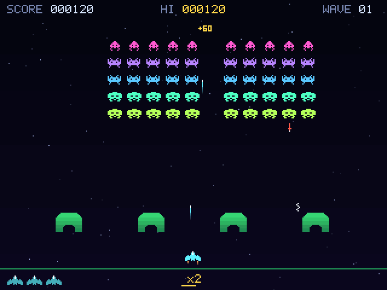
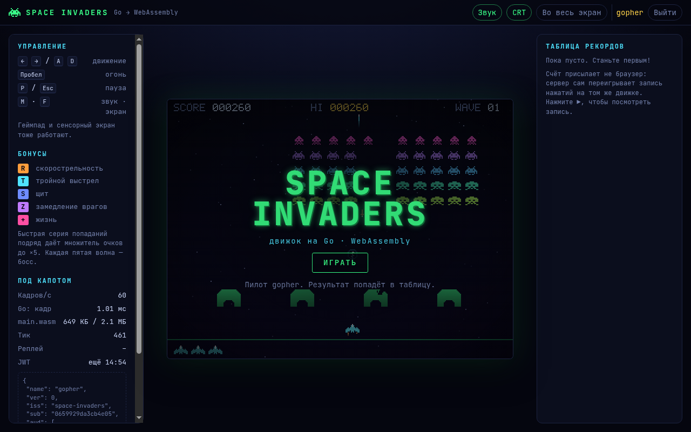
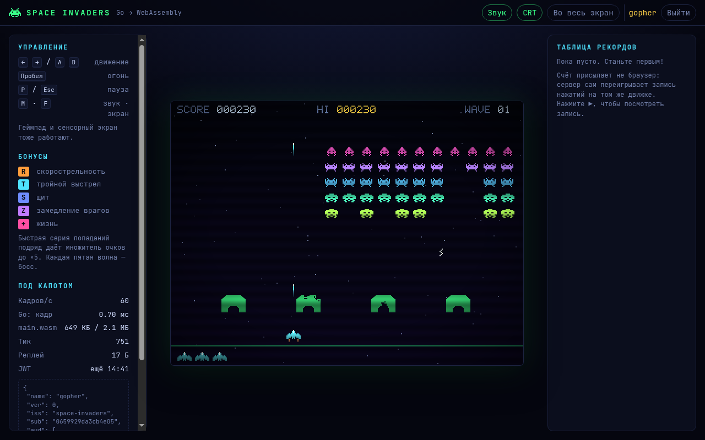
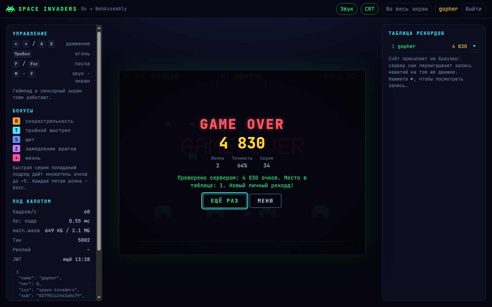
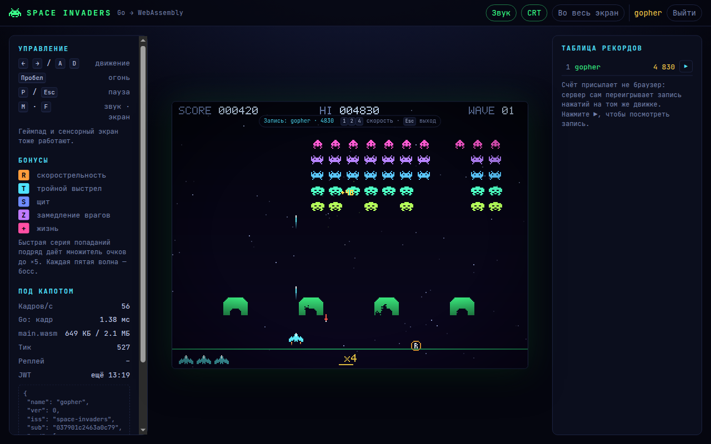
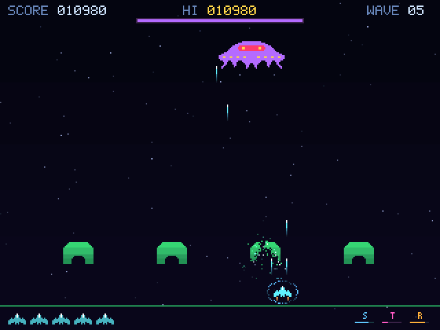
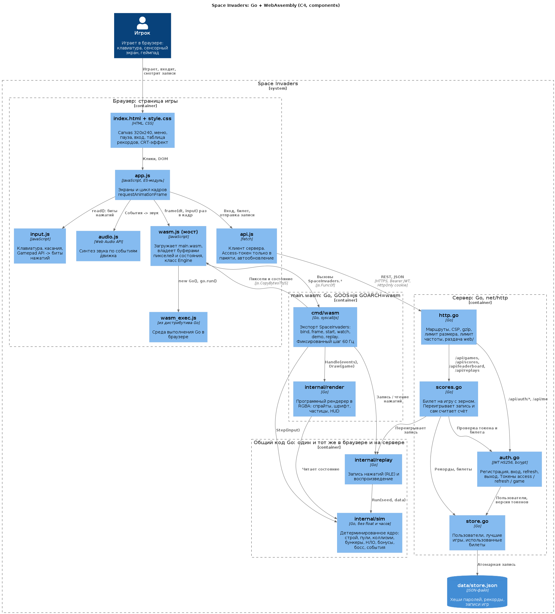

<div align="center">

# Space Invaders: Go + WebAssembly

**Классическая аркада, в которой весь игровой движок написан на Go и работает в браузере как WebAssembly-модуль.**

[](https://github.com/ivanroj/space-invaders/actions/workflows/ci.yml)




[▶ Видео: живая игра от регистрации до просмотра записи, 3:37](docs/media/gameplay.mp4)

</div>

JavaScript остаётся тонким мостом: он передаёт в Go нажатые клавиши и показывает
на `<canvas>` кадр, который нарисовал Go. Таблица рекордов защищена JWT, а счёт
сервер считает сам, переигрывая запись нажатий на том же движке.

| Меню и демо-режим | Игра |
|---|---|
|  |  |
| **Счёт проверен сервером** | **Просмотр записи из таблицы** |
|  |  |

<details>
<summary>Босс пятой волны</summary>



</details>

## Содержание

- [Быстрый старт](#быстрый-старт)
- [Управление](#управление)
- [Что есть в игре](#что-есть-в-игре)
- [Структура проекта](#структура-проекта)
- [Как это устроено](#как-это-устроено)
- [API сервера](#api-сервера)
- [Тесты](#тесты)
- [Учебный маршрут с заданиями](docs/LEARNING.md)

## Быстрый старт

Нужен только Go 1.24 или новее. Node.js, npm и сборщики не нужны.

```bash
./build.sh run          # собрать main.wasm и запустить сервер
# открыть http://localhost:8080
```

Другие команды:

```bash
./build.sh              # только сборка: web/main.wasm и web/wasm_exec.js
./build.sh test         # go vet, тесты, затем сборка
JWT_SECRET=$(openssl rand -hex 32) go run ./cmd/server -addr :8080 -data data/store.json
go run ./cmd/snapshot -seed 7 -ticks 600,2400 -out shots   # кадры в PNG без браузера
```

Без `JWT_SECRET` сервер создаёт случайный ключ на время работы и предупреждает,
что после перезапуска все сессии станут недействительны.

### Docker

```bash
docker build -t space-invaders .
docker run --rm -p 8080:8080 -e JWT_SECRET=$(openssl rand -hex 32) -v si-data:/data space-invaders
```

Образ собирается в два этапа: Go компилирует `main.wasm` и сервер, в итоговый
образ на базе distroless попадают только бинарник и папка `web/`.

## Управление

| Действие | Клавиатура | Геймпад | Телефон |
|---|---|---|---|
| Движение | ← → или A D | крестовина, левый стик | кнопки ◀ ▶ |
| Огонь | Пробел, W, Z, ↑ | A, X, правый триггер | кнопка ОГОНЬ |
| Пауза | P, Esc | | кнопка паузы |
| Старт, продолжить | Enter | Start | кнопки на экране |
| Звук, полный экран | M, F | | кнопки в шапке |
| Скорость записи | 1, 2, 4 | | |

## Что есть в игре

- 5 рядов по 11 захватчиков, строй ускоряется по мере того как редеет.
- Разрушаемые бункеры: каждое попадание выгрызает пиксели.
- НЛО с бонусными очками, пять видов бонусов, множитель за серию до ×5.
- Каждая пятая волна — босс с тремя схемами атаки и яростной фазой.
- Демо-режим в меню: в игру играет встроенный бот.
- Запись любой игры из таблицы рекордов можно посмотреть на скорости ×1, ×2, ×4.
- Звук синтезируется через Web Audio API, файлов со звуком нет.

## Структура проекта

```
space-invaders/
├── build.sh               сборка Wasm-пакета
├── cmd/
│   ├── wasm/main.go       точка входа браузерной сборки, экспорт API в JS
│   ├── server/main.go     HTTP-сервер: статика, JWT, рекорды
│   └── snapshot/main.go   рендер кадров в PNG без браузера
├── internal/
│   ├── sim/               детерминированное ядро: движение, коллизии, события
│   ├── render/            программный рендерер в RGBA-буфер, шрифт, спрайты, эффекты
│   ├── replay/            запись и воспроизведение нажатий
│   └── server/            аккаунты, JWT, билеты на игру, проверка счёта, хранилище
├── web/
│   ├── index.html         интерфейс игры
│   ├── style.css
│   ├── wasm.js            мост между Wasm и страницей
│   ├── app.js             экраны, кнопки, цикл кадров
│   ├── input.js           клавиатура, сенсорный экран, геймпад
│   ├── audio.js           синтез звука
│   ├── api.js             клиент сервера, хранение JWT
│   ├── main.wasm          скомпилированный Go-код (создаёт build.sh)
│   └── wasm_exec.js       поддержка Go в браузере (копирует build.sh)
└── docs/
    ├── LEARNING.md        учебный маршрут по коду с заданиями
    ├── architecture.puml  диаграмма C4
    └── architecture.png
```

## Как это устроено



### 1. Компиляция Go в WebAssembly

```bash
GOOS=js GOARCH=wasm go build -trimpath -ldflags="-s -w" -o web/main.wasm ./cmd/wasm
```

`GOOS=js GOARCH=wasm` выбирает браузер как целевую платформу. Файл
`cmd/wasm/main.go` помечен `//go:build js && wasm`, поэтому в обычную сборку он
не попадает. `wasm_exec.js` берётся из того же дистрибутива Go, что и
компилятор: версии должны совпадать, иначе модуль не запустится.

Модуль весит около 2,1 МБ, по сети с gzip передаётся около 640 КБ. Сервер
отдаёт его с типом `application/wasm`, без которого браузер не может
компилировать модуль во время загрузки (`WebAssembly.instantiateStreaming`).

### 2. Мост между Wasm и страницей

Go публикует один объект `globalThis.SpaceInvaders`. `web/wasm.js` оборачивает
его в класс `Engine`.

| Вызов | Что делает |
|---|---|
| `bind(pixels, state)` | Go запоминает два буфера, которыми владеет JS |
| `frame(dtMs, input)` | один вызов на кадр: симуляция, отрисовка, отчёт о состоянии |
| `start(seed)` | новая игра с записью нажатий |
| `watch(seed, replay)` | воспроизведение записи |
| `demo()` | демо-режим с ботом |
| `setPaused`, `setHiScore` | пауза и рекорд для HUD |
| `replay()` | запись текущей игры в виде `Uint8Array` |

Граница между JS и Wasm стоит дорого, поэтому она пересекается один раз за
кадр. Go пишет картинку 320×240 в `Uint8ClampedArray`, а числа (счёт, жизни,
волна, события для звука) в `Int32Array`. Оба буфера созданы в JS, Go копирует
в них данные через `js.CopyBytesToJS`. Индексы полей Go тоже публикует, чтобы
две стороны не разошлись.

### 3. Игровой движок

- **Фиксированный шаг.** Симуляция идёт ровно 60 тактов в секунду при любой
  частоте экрана. `frame` копит прошедшее время и выполняет нужное число тактов.
- **Детерминизм.** Целочисленная арифметика с фиксированной точкой (1 пиксель
  = 256 единиц), собственный генератор случайных чисел SplitMix64, никаких
  часов и `float` в логике. Одно зерно и одни нажатия всегда дают одну игру.
- **Коллизии.** Прямоугольники (AABB) для кораблей и пуль, попиксельная маска
  для бункеров.
- **События.** Ядро не знает про звук и эффекты. Оно выдаёт список событий
  (`EvInvaderKilled`, `EvBossHit`, …), по которым рендерер создаёт частицы, а
  JS играет звук.
- **Без мусора.** Все объекты лежат в массивах фиксированного размера, в
  игровом цикле нет выделений памяти, сборщик мусора не вызывает рывков.

### 4. JWT и защита таблицы рекордов

Три вида токенов, все HS256, различаются полем `aud`:

| Токен | Срок | Где хранится | Зачем |
|---|---|---|---|
| access (`aud: api`) | 15 минут | в памяти страницы | заголовок `Authorization: Bearer` |
| refresh (`aud: refresh`) | 7 дней | cookie `HttpOnly`, `SameSite=Strict`, путь `/api/auth` | выдача нового access |
| билет на игру (`aud: game`) | на время игры | в памяти страницы | связывает игрока, зерно и время старта |

JWT доказывает, **кто** прислал результат, но не доказывает, что результат
честный: вошедший игрок может отправить любое число. Поэтому браузер число не
отправляет вовсе.

1. `POST /api/games`: сервер выбирает зерно и подписывает билет.
2. Игрок играет, Go записывает нажатия (игра на полчаса занимает до 20 КБ).
3. `POST /api/scores`: браузер отправляет билет и запись.
4. Сервер переигрывает запись на том же пакете `internal/sim` и берёт счёт из
   результата.

Сервер отклоняет запись, если билет подделан, чужой или уже использован, если
игра в записи не закончилась, если запись длиннее времени, прошедшего с выдачи
билета, или если она сделана другой версией движка.

Остальное: пароли хранятся как bcrypt-хеши, вход и регистрация ограничены по
частоте, выход отзывает все выданные токены, алгоритм подписи закреплён
(`alg: none` и подмена алгоритма не проходят), страница отдаётся со строгой
Content-Security-Policy.

## API сервера

| Метод и путь | Доступ | Назначение |
|---|---|---|
| `GET /api/health` | все | проверка и версия движка |
| `POST /api/auth/register` | все | регистрация |
| `POST /api/auth/login` | все | вход |
| `POST /api/auth/refresh` | cookie | новый access-токен |
| `POST /api/auth/logout` | cookie | выход, отзыв токенов |
| `GET /api/me` | Bearer | профиль и личный рекорд |
| `POST /api/games` | Bearer | билет на игру и зерно |
| `POST /api/scores` | Bearer | отправка записи на проверку |
| `GET /api/leaderboard` | все | таблица рекордов |
| `GET /api/replays/{id}` | все | запись лучшей игры пользователя |

## Тесты

```bash
go test ./...
```

- `internal/sim`: детерминизм, бот проходит волны на нескольких зёрнах.
- `internal/replay`: кодирование туда и обратно, испорченные данные, фаззинг.
- `internal/server`: регистрация, вход, обновление и отзыв токенов, cookie,
  ограничение частоты, поддельные и чужие билеты, повторная отправка,
  подделанные и незаконченные записи, CSP, сохранение на диск.

## Источники

- Жерар Галлан, «WebAssembly в действии» (2022): устройство модуля, загрузка
  через `instantiateStreaming`, обмен данными через память, вызовы между JS и
  модулем.
- Туториал «Создаём высокопроизводительное приложение с WebAssembly на Rust»:
  идея держать вычисления в Wasm, а в JS оставить тонкую прослойку.
- Документация Go: `syscall/js`, [Go Wiki: WebAssembly](https://go.dev/wiki/WebAssembly).
